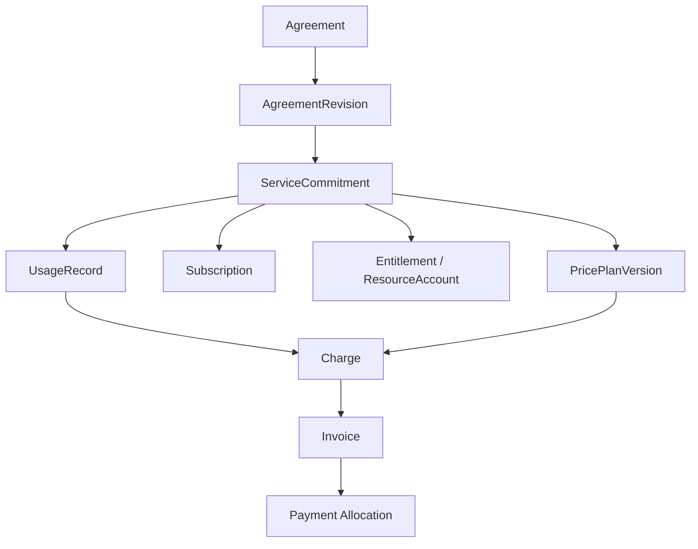
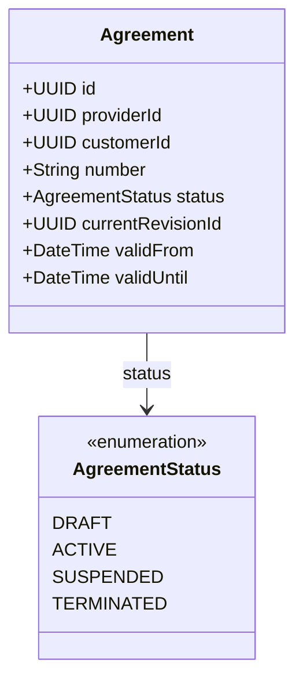
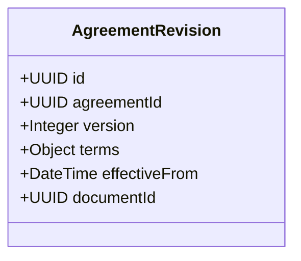
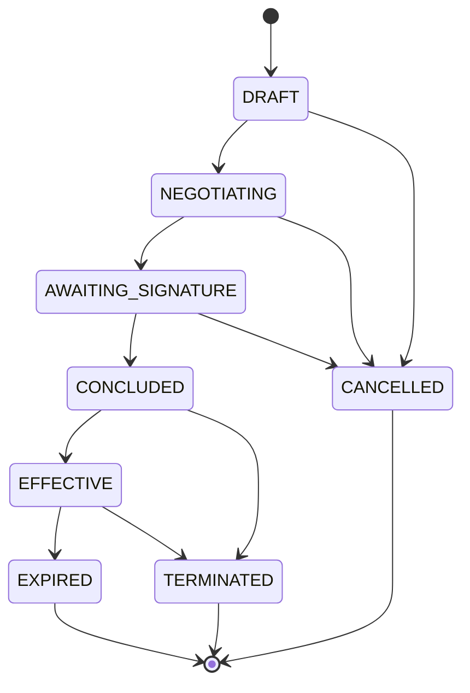

# Доменная модель и жизненный цикл коммерческих отношений

Ниже будут описаны концептуальные модели, не окончательная реализация.

## 1. Общая доменная модель (Bounded Contexts)

 - `Contracts` - Юридическое основание отношений (Agreement, AgreementRevision, LegalDocument)
 - `Commercial Commitments` - Какие услуги и на каких условиях предоставляются (ServiceCommitment, Subscription, Order)
 - `Catalog & Pricing` - Правила расчёта стоимости (Product, PricePlan, PriceComponent)
 - `Entitlements` - Права, лимиты, остатки (Entitlement, ResourceAccount, Allocation)
 - `Metering` - Учёт фактического потребления (Meter, UsageEvent, UsageRecord)
 - `Billing` - Начисление и расчёты (BillingAccount, Charge, Invoice)

### Ключевые зависимости

**ПРИМЕЧАНИЕ**: Стрелки на схеме обозначают логические связи, а не вложенность агрегатов или отношения таблиц.

## 2. `Contracts` - юридические отношения

### 2.1 `Agreement` - договор (главный агрегат)

`providerId` и `customerId` ссылаются на участников коммерческих отношений. Могут быть представлены более общей моделью сторон (AgreementParty) для поддержки дополнительных ролей и нескольких участников.

**Ответственности агрегата**:
 - Управление состоянием договора.
 - Контроль возможности изменения его условий.
 - Фиксация согласованных редакций.
 - Обеспечение целостности сторон и сроков.
 - Фиксация юридического завершения отношений.

### 2.2 `AgreementRevision` - редакция договора

Договор должен быть неизменяемый, новые условие прописываются в новой версии редакции.

`AgreementTerms` - описывает согласованные условия, включая коммерческие позиции договора.

После подписание редакция становится неизменяемой. Новая редакция не должна затирать обязательства по предыдущей, нужно сохранять интервалы действия условий и ссылки на юридическое основание изменения.

**Упрощённая модель жизненного цикла**

| **Статус** | **Значение** |
|---|---|
| DRAFT | Подготовка договора |
| NEGOTIATING | Согласование условий |
| AWAITING_SIGNATURE | Ожидание заключения договора |
| CONCLUDED | Договор заключён, но его действие ещё не началось |
| EFFECTIVE | Договор действует |
| EXPIRED | Срок действия истёк |
| TERMINATED | Действие договора прекращено |
| CANCELLED | Проект договора отменён до заключения |

**Инвариант**: договор может изменять юридические обязательства только при наличии соответствующего правового основания.
