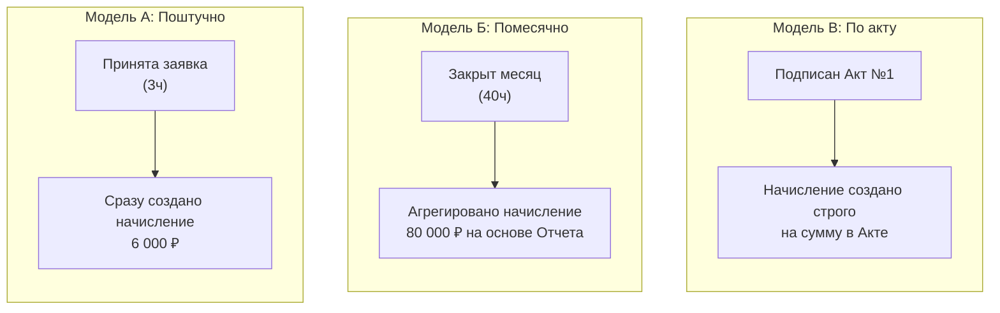

# Основные сценарии

## `UC-01` Заключение договора между организациями

**Цель**: юридически оформить коммерческие отношения между исполнителем и заказчиком.

**Участники**: исполнитель, заказчик, уполномоченные представители организации.

### Основные сценарии

1. Исполнитель выбирает организацию-заказчика либо приглашает внешнего контрагента.
2. Создаёт проект договора, указывает предмет, сроки, условия и стороны.
3. Определяет предоставляемые услуги и согласованные коммерческие условия.
4. Передаёт договор на согласование заказчику.
5. Стороны согласовывают и подписывают договор выбранным допустимым способом.
6. Система фиксирует итоговую редакцию договора, подписи или подтверждения подписания.
7. При наступлении предусмотренных договором условий договор вступает в силу.

### Альтернативные сценарии

**Сценарий A1: Заказчик отклоняет условия или направляет замечания**

 1. На шаге [4](#uc-01-main-step4) Заказчик нажимает кнопку «Отклонить» или «Направить протокол разногласий».
 2. Система требует обязательное заполнение текстового поля с комментариями или загрузку файла замечаний.
 3. Система переводит договор в статус «На доработке» и возвращает его Исполнителю с уведомлением.
 4. Исполнитель вносит правки (переход на шаг [2](#uc-01-main-step2) Основного сценария).

**Сценарий A2: Подписание не состоялось (истек срок ожидания)**

1. Если стороны не подписали договор в течение установленного регламентом срока.
2. Система автоматически аннулирует сессию подписания.
3. Договор переходит в статус «Архив / Не подписан». Всем участникам уходит уведомление.

**Сценарий A3: Регистрация договора после подписания на бумаге**

1. Если стороны решили подписать договор физически, Исполнитель выбирает тип подписания «На бумажном носителе».
2. Система генерирует финальную печатную форму.
3. После физического подписания Исполнитель загружает скан-копию всех страниц документа в систему.
4. Исполнитель вручную указывает реквизиты подписей (даты, ФИО).
5. Система фиксирует статус «Подписан (бумажная копия)» и архивирует документ.

**Ожидаемый результат**: в системе появляется действующий договор, имеющий определённых участников, юридическое основание и согласованные условия.

**Критический инвариант**: невозможно незаметно изменить условия уже подписанного договора.

При этом подписание и вступление в силу - могут быть разными событиями. Договор может начинать действовать с будущей даты или после выполнения дополнительных условий.

## `UC-02` Подключение услуг по договору

**Цель**: Перевести согласование и коммерческие условия в исполняемые обязательства.

Например, договор заключен на год и предусматривает:
 - ежемесячное обслуживание за 50000 ₽;
 - пакет из 20 часов поддержки;
 - оплату дополнительных часов по 2000 ₽.

### Основные сценарии

1. Исполнитель выбирает действующий договор.
2. Подключает предусмотренные договором услуги.
3. Для каждой услуги фиксирует согласованный тариф и условия применения.
4. Система создаёт соответствующие коммерческие обязательства.
5. В установленные сроки активируются подписки, пакеты и права на услуги.
6. Подключённые сервисы получают информацию о доступных ресурсах и возможностях организации.

### Альтернативные сценарии

**Сценарий A2.1: Досрочное расторжение договора (договор закрылся - подписки остались)**

1. Юридический договор переводится в статус Расторгнут» до окончания планового года.
2. Система выполняет каскадное изменение: находит все связанные активные подписки и принудительно выставляет им дату окончания, равную дате расторжения договора.
3. Биллинг производит пропорциональный расчет (Pro-rata) за неполный месяц пользования услугой (например, если обслуживание за 30 000 ₽ отключили в середине месяца, к оплате выставляется 15 000 ₽).

**Сценарий A2.2: Пакет часов израсходован раньше конца месяца**

1. Например, на 15-е число месяца заказчик тратит 20 часов поддержки. Баланс пакета становится 0.
2. DIO-Desk отправляет запрос в Contacts & Billing: <i>заказчик пытается открыть заявку на 2 часа</i>.
3. Система проверяет план подписки и плотики риска, видит условие «Доп. часы по 2 000 ₽» и разрешает тарификацию по постоплате. Записывается коммерческое обязательство на 4 000 ₽.

**Сценарий A2.3: Заявка на стыке лимита**

 - **Суть**: Проверяет правильность разделения одной транзакции на «бесплатную» и «платную» части.
 - **Кейс**: У клиента осталось 1,5 часа в пакете. DIO Desk отправляет запрос на закрытие задачи, которая заняла 3 часа.
 - **Поведение системы**: Система должна автоматически разделить эти 3 часа:
     - 1,5 часа списать в счёт остатка пакета (баланс пакета становится 0);
     - Остальные 1,5 часа тарифицируются как овердрафт (если политика риска позволяет) по ставке 2 000 ₽/час (начислить обязательство на 3 000 ₽).

**Ожидаемый результат**: договор существует как юридическое основание, а подключённые по нему услуги имеют собственные сроки, условия тарификации и учёта.

**Критический момент**: один договор может включать несколько независимых услуг, но для отдельной услуги должно быть понятно, какие именно условия применяются.

## `UC-03` Использование предоплаченного пакета часов

**Цель**: обеспечить предоставление услуг в пределах заранее приобретённого объёма ресурсов.

### Основной сценарий

 1. По договору приобретается пакет из 100 часов.
 2. После выполнения условий предоставления пакета на ресурсный счёт заказчика зачисляются 100 часов.
 3. Инженер выполняет работы по заявке DIO Desk, затратив 3 часа.
 4. Заказчик принимает выполненные работы.
 5. DIO Desk публикует событие о принятии 3 часов работы.
 6. Contracts & Billing определяет применимое коммерческое обязательство и ресурсный пакет.
 7. Из пакета списываются 3 часа.
 8. Обе организации видят актуальный остаток и основание списания.

**Ожидаемый результат**: остаток становится 97 часов, а в журнале операций фиксируется списание, связанное с конкретной заявкой.

### Альтернативные сценарии

**Сценарий A3.1: Повторная доставка события**

**Суть**: Работы по заявке согласованы, DIO Desk отправляет событие о списании 3 часов, но, к примеру, из-за сбоя сети событие публикуется дважды (дублирование сообщения).

**Ожидаемое поведение**: Contracts & Billing  должен поддерживать дедупликацию и идемпотентную обработку. Каждое событие из DIO Desk должно содержать уникальный ключ идемпотентности (idempotency key). При повторном получении того же ключа система игнорирует списание и оставляет остаток 97 часов.

**Сценарий A3.2: Исправление трудозатрат**

**Суть**: Заявку приняли на 3 часа (остаток стал 97), но позже обнаружили ошибку в учете времени. Менеджер в DIO Desk скорректировал списание: фактическое время составило 2 часа.

**Ожидаемое поведение**: DIO Desk публикует корректирующее событие. Биллинг находит исходную транзакцию списания и выполняет коррекцию - при уменьшении времени: возвращает 1 час в пакет (остаток становится 98)

### Критические ситуации 
 - повторная доставка события; 
 - недостаточный остаток; 
 - исправление трудозатрат;
 - отсутствие согласования;
 - истечение срока действия пакета.

## `UC-04` Оплата по факту оказания услуг

**Цель**: автоматически рассчитывать стоимость работ без предоплаченного пакета.

**Пример**: стоимость часа технической поддержки - 2 000 ₽.

### Основной сценарий

 1. Исполнитель выполняет заявку.
 2. Заказчик принимает 3 часа работы.
 3. DIO Desk передаёт факт принятой работы.
 4. Система определяет применимый договор и тариф.
 5. Рассчитывает стоимость: 3 × 2 000 ₽ = 6 000 ₽.
 6. Формирует начисление, связанное с выполненной работой.
 7. В конце расчётного периода включают начисление в счёт заказчику.

**Ожидаемый результат**: оказанные услуги учитываются и подлежат оплате в соответствии с условиями договора.

### Что именно является считается оплачиваемым событием?

Чтобы не хардкодить логику в архитектуре Contracts & Billing, введём понятие **Billing Trigger Event** (Триггер начисления). В планах или условиях для конкретной услуги должен быть явный атрибут, определяющий этот триггер.

Есть 3 основные бизнес-модели, система должна уметь гибко переключаться между ними на основе настроек договора:

**Модель A: Приём отдельной работы (Заявочный биллинг)**

Каждое событие, например, из DIO Desk о приемке задачи сразу порождает финансовую транзакцию в статусе `Unbilled` (к выставлению).

**Модель Б: Согласование отчёта за месяц (Агрегированный биллинг)**

События из DIO Desk просто накапливаются в биллинге как нетарифицированные сырые метрики. В конце месяца формируется черновик отчета. Как только менеджеры нажимают «Согласовать отчет», биллинг одной транзакцией рассчитывает всю сумму за месяц.

**Модель В: Подписание акта (Юридический биллинг)**

Начисления формируются только тогда, когда из ERP-системы или ЭДО приходит статус «Акт подписан обеими сторонами».

### Альтернативные сценарии

**Сценарий A4.1: смена тарифа «задним числом» до выставления счета**

 1. В течении месяца (октября) инженер наработал 10 часов по тарифу 2 000 ₽ (система посчитала 20 000 ₽).
 2. 1-ого числа нового месяца (1 ноября) (до выставление финального счёта) стороны подписывают доп.соглашение, в котором задним числом с 1 числа (1 октября) утверждают тариф 1 800 ₽.
 3. Contracts & Billing при запуске процедуры закрытия периода (Billing Run) проверяет актуальную на момент расчета версию тарифа для октября. Система должна автоматически пересчитать (Re-rate) накопленные за месяц начисления по новой ставке: 10 × 1 800 ₽ = 18 000 ₽.

**Сценарий A4.2: Клиент оспаривает часы по конкретным работам в конце месяца**

**Суть**:  В отчете за месяц фигурируют 5 заявок. Заказчик согласен оплатить четыре из них, но по одной (на 5 часов / 10 000 ₽) открывает спор (диспут), так как недоволен качеством.

**Ожидаемое поведение**: Система должна уметь переводить конкретное коммерческое начисление в статус `Disputed` (Заблокировано для счета). При формировании счета за месяц эти 10 000 ₽ исключаются из текущего инвойса, чтобы не задерживать оплату по остальным позициям. После разрешения спора эти 5 часов либо списываются в ноль, либо переходят в следующий счет.

**Сценарий A4.3: Заявка «переходящая» через границу расчетного периода**

**Суть**: Расчетный период - календарный месяц. Крупная заявка открыта 28 октября, инженер работал над ней ежедневно, а заказчик принял её только 3 ноября (всего 15 часов). В каком месяце должна произойти оплата?

**Ожидаемое поведение**: Ответ зависит от настройки договора:

 - Если триггер - приемка работы, то все 15 часов тарифицируются и падают в счет за ноябрь (так как дата приемки - 3 ноября).
 - Если договор требует оплаты по факту трудозатрат за месяц, DIO Desk должен передавать промежуточные срезы (например, 10 часов за октябрь, 5 часов за ноябрь), и биллинг разнесет сумму пропорционально по двум разным счетам.

## `UC-05` Подключение и использование SaaS-подписки

**Цель**: предоставить организации доступ к сервисам DIOS в соответствии с выбранным тарифом.

### Основной сценарий

 1. Организация выбирает тариф DIOS Cloud (как пример).
 2. Принимает юридические условия предоставления сервиса (например, оферту).
 3. Оформляет подписку.
 4. После выполнения условий активации система предоставляет оплаченные возможности и квоты.
 5. Организация использует функции DIOS.
 6. Сервисы проверяют доступные права и лимиты.
 7. Система учитывает потребление тарифицируемых ресурсов.
 8. По окончании периода подписка продлевается или изменяет состояние согласно согласованным условиям.

**Ожидаемый результат**: организация получает доступ к оплаченным возможностям без необходимости настраивать отдельную интеграцию биллинга для каждого сервиса.

## `UC-06` Исчерпание квот и сверхлимитное потребление

**Цель**: обеспечить соблюдение коммерческих ограничений и корректное применение правил сверхлимита.

### Основной сценарий:
 1. Заказчик использует ресурс с установленным лимитом.
 2. Система определяет доступный остаток.
 3. При достижении лимита применяет предусмотренную политику.
 4. Потребление блокируется, допускается сверхлимитная тарификация либо создаётся уведомление.
 5. Все операции отражаются в истории потребления.

**Ожидаемый результат**: система однозначно определяет, какая часть потребления покрывается включённым объёмом, а какая оплачивается отдельно.

**Важный нюанс**: для AI-токенов жёсткая квота может проверяться непосредственно перед выполнением операции. Но для часов технической поддержки, которые списываются после приёмки работ, уже поздно запрещать выполненную работу. Поэтому при жёстких лимитах потребуется предварительное согласование или резервирование ресурсов.

## `UC-07` Закрытие расчётного периода

**Цель**: зафиксировать обязательства сторон по итогам периода.

### Основной сценарий:
 1. Наступает дата завершения расчётного периода.
 2. Система собирает все относящиеся к нему начисления.
 3. Проверяет полноту и корректность данных.
 4. Применяет необходимые тарифные правила и корректировки.
 5. Формирует итоговый счёт и детализацию потребления.
 6. После утверждения фиксирует документы и результаты расчётов.
 7. Передаёт данные во внешнюю бухгалтерскую систему или ЭДО, если это предусмотрено.

**Ожидаемый результат**: заказчик и исполнитель получают согласованную детализацию услуг и суммы к оплате.

**Критическая ситуация**: после закрытия периода поступило событие о работе, фактически выполненной в прошлом периоде. Система должна иметь определённую политику поздних событий: доначисление, корректировка либо включение в следующий расчётный период.

## `UC-08` Исправление ранее учтённых операций

**Цель**: обеспечить возможность исправления ошибок без потери финансовой истории.

**Пример**: в DIO Desk первоначально согласовали 5 часов, но позднее установили, что фактически было 3 часа.

### Основной сценарий:
 1. Уполномоченный участник инициирует корректировку.
 2. Система проверяет основания и права на изменение.
 3. Исходная операция остаётся в истории.
 4. Создаётся корректирующая операция на −2 часа потребления.
 5. Если часы были списаны из пакета, восстанавливаются 2 часа.
 6. Если была начислена оплата, формируется соответствующая финансовая корректировка.
 7. При необходимости формируются исправленные документы.

**Ожидаемый результат**: остатки и финансовые обязательства соответствуют скорректированным данным, а исходное состояние и причины изменения доступны для аудита.

## Критические негативные сценарии

| **Ситуация** | **Ожидаемое поведение** |
|---|---|
| Одно событие потребления поступило дважды | Повторное списание или начисление не производится |
| Два потребителя одновременно списывают последний доступный ресурс | Не допускается двойное расходование при жёстком лимите |
| Работа принята после окончания расчётного периода | Применяется определённая политика позднего потребления |
| Подписка продлена повторным запросом | Не возникает двух начислений за одно продление |
| Действующий тариф изменён | Исторические расчёты сохраняют прежние условия |
| Договор истёк до момента приёмки выполненной работы | Операция разрешается по договорным правилам и времени оказания услуги |
| У организации несколько подходящих договоров | Неоднозначное списание исключается |
| Уже выставленный счёт оказался ошибочным | Формируется корректировка без изменения исходного документа |
| Организация не оплатила счёт | Применяется установленная политика задолженности, льготного периода и ограничений |
| Потребление зафиксировано, но сервис биллинга временно недоступен | Событие не теряется и может быть безопасно обработано повторно |

## Основные бизнес инварианты

| **Инвариант** | **Значение** |
|---|---|
| Юридическое основание | Каждое коммерческое обязательство имеет определённое правовое основание |
| Однозначность тарификации | Каждое тарифицируемое потребление относится к однозначно определённым коммерческим условиям |
| Отсутствие двойного учёта | Один бизнес-факт не может создавать повторные списания или начисления |
| Историческая неизменяемость | Подтверждённые финансовые операции исправляются корректировками |
| Воспроизводимость расчётов | Можно объяснить, почему, по какому тарифу и за что начислена сумма |
| Разделение денег и ресурсов | Оплата пакета и расходование его ресурсов являются разными операциями |
| Изоляция коммерческих отношений | Ресурсы и обязательства одной пары сторон не смешиваются с другими |
| Согласованность доступа | Коммерческие права организации не заменяют пользовательскую авторизацию |
| Контролируемое завершение | Прекращение договора не уничтожает задолженности, историю и обязательства по уже оказанным услугам |
